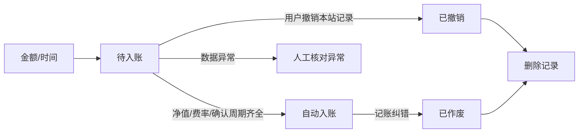

# 真实平台交易的记录与核对

更新：2026-11-08。本站不提供交易；“模拟”仅表示不发起交易，用户记录的数据来自其他平台真实交易。数据不齐时保留待确认状态，不能编造成交、替换日期或覆盖平台回执的份额。

## 三个时间分开

- **申请时间 submitted_at**：用户实际在平台提交/有效受理的时刻，保存北京时间到秒。用户所在设备时区不改变记账时区。
- **净值所属日 confirmed_on**：该笔买卖使用哪一个交易日的净值。兼容旧 API 字段名，界面统一叫“净值所属日”，它不是平台确认日。
- **平台确认日 settled_on**：平台实际确认成交份额、费用的日期，可按回执补充；未填写时保留空值，不能反过来决定净值所属日。

普通境内场外基金按北京时间：

| 申请时间 | 净值所属日 |
| --- | --- |
| 交易日 15:00:00 前 | 当日 |
| 交易日 15:00:00 起 | 下一交易日 |
| 周末、休市日 | 后续首个交易日 |

例如 2026-11-06（周五）14:59:59 对应 11-06；15:00:00 对应 11-09（周一）。2026-09-30 15:00 对应国庆节后 10-08。2026-10-10 虽是社会补班周六，证券市场仍休市，归属 10-12。

“当日净值”是当日收盘后公布的官方净值，盘中页面看到的最近净值通常属于之前的交易日。系统不把它用作当前申请的成交净值，也不把盘中估值当作成交数据。

## 交易日历与特殊规则

已核对日历覆盖 2025、2026 年；未知年份及跨出已核对范围时拒绝自动推算。周末与节假日按证券交易所休市安排处理，不能使用行政补班日历替代。

来源：

- [上交所年度休市安排（2026，2026-11-08 核对）](https://www.sse.com.cn/disclosure/dealinstruc/closed/)
- [2025 年部分节假日休市安排通知](https://www.sse.com.cn/disclosure/announcement/general/c/c_20241223_10767108.shtml)
- [2026 年部分节假日休市安排通知](https://www.sse.com.cn/disclosure/announcement/general/c/c_20251222_10802507.shtml)

统一规则仅用于用户选定的普通境内场外申赎；基金“股票/指数”等大类无法区分场内买卖。场内 ETF/LOF 按撮合价、QDII 按海外市场与产品合同、货币基金等特殊类型不能简单套用境内 15:00 规则。系统对 qdii/money/fof/other 拒绝该自动规则；用户可选择“按平台回执”填写净值日与依据。其他产品有特殊开放日、暂停申赎、平台有效受理时间差异时也以平台实际回执为准，并保留原因。

## 自动查询与费用计算

默认只填写金额/份额与实际下单时间。系统自动确定15:00截止对应交易日、查询同日官方净值；查不到会按需补查该只基金历史净值。申购/赎回费来自公开交易费率表，缓存24小时，包含金额档位、持有期条件和来源，不使用管理费或托管费替代交易费。

申购费用采用外扣法：总金额 − 总金额÷(1＋申购费率)，固定每笔费用按其档位处理。不同金额边界、费率阶梯必须明确匹配；未知条件保持待处理，不填0。

赎回根据同平台实际买入流水重建FIFO剩余批次，优先用实际平台确认日作为持有期起点；缺少时暂以净值日估算并注明。每个批次按天数或实际周年/月匹配费率，分别取整到分再汇总；年/月不粗暴换成365天。平台的具体持有期规则、分红与转换尚不完全覆盖，因此自动计算不能冒充已核验成交。

未填平台默认以公开标准费率计算，填“天天基金”时可用该来源公开优惠费率；不把同一渠道的优惠费率套给支付宝等其他渠道。实际平台折扣、历史费率变更、确认份额精度、后端收费选择等可能不同，自动记录来源是 estimated，带 calculation_basis，界面明确显示并能查看费率表/持有批次；按平台实际回执录入的记录仍为 receipt。

净值或费率不足时先保存 automatic_processing=true 的待处理申请；在已有采集任务完成之后和用户打开待处理清单时尝试补齐。原来明确选择待平台确认的人工记录不自动处理，不新增隐式后台调度器。

数据齐全时自动计算入账，之后可依照现有末笔作废并补录真实回执的流程校正。自动持仓、回执持仓和旧折算分别统计，未来AI不得把估算当作已核验事实。

## 简化录入

点击基金旁的买入/加仓，默认只填写“买了多少钱”和“什么时候买的”，时间预填当前北京时间。
卖出则填份额和卖出时间。点击“自动计算并保存”后查询并保存，平台和备注可以稍后补，用户无需选择净值日期规则或记录状态。

系统使用 `pricing_rule=auto`：普通境内基金且日历已核对时自动计算净值日；特殊品种、未核对年份或跨年超出范围时保留未知净值日，仍允许先保存申请。未知日期不推算为工作日，也不提前生成成交。

正常流程不需要补充成交结果；只有异常核对入口展开后才按实际平台信息录入。同日官方净值已取得时自动使用，取不到才展示成交净值输入；平台日期或价格不同，可展开“调整日期或净值”。实际平台确认日期、编号与备注选填，缺少时留空，不用当前日期代填。预览后确认才更新持仓。

## 正常生命周期

用户保存申请后，无需“补充成交结果”：系统查询相应净值日、交易费率和公开买入/卖出确认周期，自动等待入账。T+1是下一证券交易日，周末与休市日顺延；不能因为当晚有净值就直接认定已经确认。公开规则未取得时保持待入账，不编造确认日期。

正常待入账只提供“撤销记录”，停止本站自动处理；仅日期未知、费用条件不明确、跨平台份额不足等异常提供“处理异常”。已入账记录把本站纠错操作收在“更多”中，可从同基金最后一笔开始作废，不把已入账作废误称为平台撤单。

撤销仅作用于本站记录。真实平台一般受交易日、15:00截止、申请受理状态、产品及销售平台规则约束，本站未接交易平台时不能替用户实际撤单或声称撤单成功。

## 交易记录查询

交易记录统一包含待入账、已入账、已撤销、已作废。筛选支持基金名称或代码、买卖方向、状态、下单日期；数据库完成分页，界面可选10/20/50/100条并切页，条件变化回到第一页。删除末页最后一条后自动回退。

只允许删除已撤销/已作废记录，有效持仓不受影响。删除后保留请求编号墓碑，网络重试不会重新入账。申请转成交只显示成交，成交作废/删除也不会再重复出现已关联申请。全流程按会员隔离。

## 数据精确性

- 买入填写实际含费总支出、回执确认份额、净值和费用，费用必须显式填入，零费用填写 0。**不使用金额÷净值推算的固定精度份额覆盖回执份额。**
- 卖出填写实际卖出份额、净值、费用及实际净到账。毛金额按净到账加费用保存，不用重算金额覆盖到账尾差。
- 自动查询只读取净值所属日当天的数据；未取得数据时明确提示，用户可按平台回执填写。净值不同于本地同日数据时提示核对，仍保留回执原值。
- 回执金额与“份额×净值”超过 0.02 元的差异展示提示并保留，不暗中改写。本站是用户录入来源，未直接接平台核验，不标记为“已平台核验”。
- 数值采用 Decimal，金额 2 位、份额最多 4 位、净值最多 6 位，超出精度拒绝而不是截断；已有回执更高精度的支持需后续专门扩展。
- 成本按平台分别结转移动平均成本，卖出不能使用其他平台的持仓份额。基金汇总合并各平台持仓。站内计算的收益属于此成本口径，不等同于不同销售平台自行定义的展示收益率。

份额清零时结转该平台全部剩余成本，基金清仓后历史已实现收益仍保留。累计收益 = 当前市值 + 卖出净收入 − 买入总支出；尚未处理分红、拆分和转换，不能声称是完整真实账户对账单。

## 一致性、纠错与旧数据

确认前重算并检查预览版本；同一请求编号重试只入账一次。确认与作废以会员写锁和数据库当前读避免并发超卖。

同一基金按净值日追加，回执还检查同平台申请时间，不能悄悄插入更早的交易改变后续成本。纠错需从同基金最后一笔有效记录倒序作废，再重新按时间录入。作废保留回执和原因；与其关联的申请不再复用，防止重复入账。

旧 `fund_positions` 不自动纳入；旧 `fund_transactions` 保留 `record_source=calculated`，不自动转为回执记录。界面展示未核对提示。历史估算、待确认申请与用户回执来源分别保存，未来 AI 必须区分，不能混作已核对事实。

## 实现

- `app/trading_calendar.py`：版本化日历和 15:00 规则；未知范围拒绝猜测。
- `services/trade_timing.py`：时间、产品规则、回执日期和差异核对。
- `models/trade_application.py` / `services/trade_application.py`：待确认记录。
- `services/transaction.py`：确认/作废和回执字段保存；`portfolio_math.py`：分平台 Decimal 成本计算。
- `useTradeForm.ts`、`ReceiptFields.vue`、`Applications.vue`：申请时间、待确认及回执录入。

接口与精度见 [API 文档](api.md)，后续项目实施顺序见 [代办](TODO.md)。
